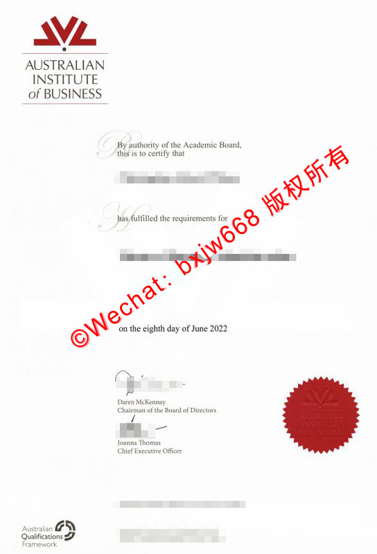

# 澳大利亚商学院（AIB）毕业证书特征辨析及境外在职学资认证合规实务

在全球数字化职场与跨国猎头背调的语境下，企业高管的学历真实性及其“含金量”审计日益严格。作为南半球知名的专注于在职高等教育的商科院校，**澳大利亚商学院（Australian Institute of Business，简称 AIB）**其全球在线/混合制 MBA 项目吸引了大量跨国企业中高层管理者修读。

然而，由于其独特的“在职修读（Work-Applied Learning）”与“远程数字化（Online Delivery）”办学标签，企业HR在面对AIB颁发的学位凭证时，往往对其真伪辨析及国境内教育部的准入合规性存在诸多审慎盲区。本文将依据 AIB 官方标准证书样本，全面解构其物理防伪特征，并针对在职学资的跨境审计实务进行深度合规指南。

## 一、 澳大利亚商学院（AIB）学位证书版面特征与核心辨析要素

与传统研究型大学繁复的古典设计不同，AIB 作为现代菁英商学院，其证书（Certificate of Degree / Diploma）在视觉上更偏向于精简、商业化与工业设计感。基于最新官方样本，其排版与核心防伪动线呈现以下特征：

### 1. 顶部主视觉：模块化红黑双色校标
证书左上方（或正上方）配置有 AIB 的法定注册商标及视觉体系：
* **几何图形：** 顶端是由三个相互交叠的倒三角形组成的折线几何抽象图标，印刷工艺呈现高饱和度的“企业红（Corporate Red）”。
* **标准字体：** 图标下方为黑色的 “AUSTRALIAN INSTITUTE *of* BUSINESS” 三行标准视觉字样，其中 “*of*” 采用富有艺术感的现代手写衬线斜体，其余为无衬线现代工业体。

### 2. 花式首字母启幕：学术授权文本
正文部分并未采用大面积的冗长表述，而是通过两个极具艺术设计感的花体大字作为视觉锚点：
* **学术授权（By authority）：** 正文第一段以一个放大的古典灰黑色花体字 **“B”** 启幕，延续 “*By authority of the Academic Board, this is to certify that...*” 的法理表述，证明证书经由学术委员会正式授权。
* **学位授予（Has fulfilled）：** 在毕业生法定姓名下方，以一个同样规格的花体字 **“H”** 启幕，连接 “*has fulfilled the requirements for...*”，随后单独列出所获得的学位（如 *Master of Business Administration* ）。
* **日期落款：** 采用标准的极简英文编排（如 *on the eighth day of June 2022* ），字体圆润，整体排版留白率极高，带有强烈的现代商务契约感。

### 3. 右下角核心防伪：立体齿轮辐射钢印（Common Seal）
作为证书上最沉重的实体法理凭证，右下角加盖有大红色的齿轮状学校法定公印。
* **物理防伪点：** 该钢印不仅在纸张背面留有清晰的按压凹凸痕迹，其正面齿轮尖端呈辐射状向外均匀扩散。
* **微缩文字：** 钢印中心区域通过重力深压，精准雕刻着 AIB 的几何三角形校标以及 “AUSTRALIAN INSTITUTE OF BUSINESS” 环形闭环字样，字体边缘在光线下层次分明，极难通过普通激光打印或复印进行高仿真复制。

### 4. 底部执行域：法定高管双签与AQF国家框架标识
* **双签落款：** 证书中下方包含两位核心执行官员的法定签署——董事会主席（Chairman of the Board of Directors）与首席执行官（Chief Executive Officer）。签名下方附有其机打职称，且通常带有签字笔手写的粗细变化与出墨不均特征。
* **AQF 认证标识：** 证书的左下角清晰印有 **Australian Qualifications Framework（澳大利亚学历资格框架）** 的官方联动绿黑色圆形齿轮环标。这标志着该文凭并非市面上的商业培训证书，而是完全纳入澳大利亚联邦高等教育法定注册管理体系的高等学位（Higher Education Award）。

## 二、 AIB 在职/远程 MBA 留服认证合规规程

围绕 AIB 产生的最高频搜索簇并非“样式”，而是 **“AIB商学院留服承认吗”**、**“远程在线MBA如何做学历认证”** 以及 **“不做出境的澳洲文凭怎么审计”**。针对这类在职学资，中国教育部留学服务中心（CSCSE）有着一套独立于全日制留学的合规穿透逻辑。

### 1. 远程/在线修读项目的合规判定红线
中国留服中心对于国（境）外学历学位认证的基本原则是**“海外空间就读与跨境实质性居留”**。因此，针对 AIB 的不同修读模式，合规准入结果存在本质差异：

* **完全合规准入类（混合制/本土就读）：** 若申请人在就读 AIB 期间，持有有效的澳大利亚学生签证（500签证），且在阿德莱德（Adelaide）总部校区或指定教学点有实质性的本土出境记录、符合官方标准学制的常态化居留时间，此类文凭回国后可顺利获得留服中心认证。
* **跨境风控审计类（纯在线远程修读）：** 若申请人全盘在华通过网络授课方式（Pure Online/Distance Learning）修读并取得 AIB 证书，且在就读期间无任何澳洲出入境记录或学生签证，根据教育部最新规定，此类**纯跨境远程文凭通常不属于留服中心的认证受理范围**。

### 2. 企业 HR 针对在职高管 AIB 文凭的“三维审计法”
鉴于纯远程文凭可能无法取得国内留服认证书，跨国企业或外企在引进持有 AIB 证书的高管人才时，应放弃单一的“留服依赖”，建立符合国际标准的**三维学资合规审计**：
* **TEQSA 状态审计：** 登录澳大利亚高等教育质量与标准署（TEQSA）官网，查询 AIB 的注册状态（Provider ID: PRV12177），确保其在颁发证书时具备合法的“高等教育机构（Higher Education Provider）”运营资质。
* **AQF 框架对齐：** 核对证书左下角标识，确认为 **AQF Level 9（硕士学位等级）**，在国际劳动力市场上，该等级等同于标准的澳大利亚国家级正规硕士学术资历。

## 三、 全球数字化教务追踪：基于 My eQuals 的 AIB 证书链真伪验证

随着无纸化办公与绿色教务的普及，澳大利亚商学院（AIB）已深度将所有毕业生的学位证与成绩单托管于澳新高校官方数字凭证网络——**My eQuals**。

### 1. 数字化证书的底层防伪机理
当 HR 收到一封来自 AIB 毕业生的官方数字共享邮件时，应当直接放弃对纸质打印件的肉眼观察，转而审查其背后的**加密数字签名（Cryptographic Signatures）**。
* **不可篡改性：** 真正的 AIB 数字文凭由学校的数字教务系统（Advanced Encryption Standard）直接加密生成。
* **信任链传递：** 当使用 Adobe Acrobat 查看该 PDF 文件时，文件顶部会强制弹出一行由公钥基础设施（PKI）触发的蓝色通知栏：“*已由 My eQuals 签名，所有签名均有效*”。任何对文本、姓名、专业名称的后期微调，都会导致该数字信任链瞬间断裂并报毒。

### 2. HR 自主验证实施规程

| 步骤 | 操作行动 | 关键核查点 |
| :--- | :--- | :--- |
| **Step 1** | 要求候选人通过 AIB 学生端发送 **My eQuals 官方共享链接** | 确保链接域名为官方托管地址（`*.myequals.edu.au` 或 `*.myequals.net`）。 |
| **Step 2** | 在线查验动态数字资产 | 检查屏幕上呈现的毕业证图像中是否包含右下角的**红色实体齿轮钢印纹路**。 |
| **Step 3** | 比对“学修对齐度” | 切换至官方成绩单（Transcript）页面，核对修读科目（Subjects）是否包含核心的商业研究方法、战略管理等 AIB 标准核心 MBA 模块，且总学分是否完全满足毕业要求。 |

## 四、 境外在职学资（AIB）跨境认证与背调的合规避错指南

为了确保企业在引才过程中规避法律风险，同时协助在职留学生理清自身文凭的合规边界，以下梳理了 AIB 文凭在国境内外流转时的三大核心避错红线：

### 1. 谨防“商业培训证书”与“学术高等学位”的混淆
市场上存在诸多非法的海外文凭买卖中介，利用 AIB 包含的“Business（商业）”一词，使用某些短期行政培训证明（Certificate of Attendance）冒充正式的学位证书（Certificate of Degree）。
* **合规辨析法：** 真正的 AIB 学位证书正文必须包含 **“is admitted to the degree of...”**（接纳其为某学位）或 **“has been awarded the...”** 法律措辞，且底部必须有 **AQF 标志**，否则一律视为非学历商业培训。

### 2. 妥善处理在职修读期间的隐私授权
由于 AIB 的学生多为在职企业高管，学校对其身份信息的保护极其严格。如果企业委托第三方背景调查机构（如首达、全景等）向 AIB 发起人工背调致函：
* **合规实务：** 必须随信附上带有候选人亲笔签名的 **《AIB Consent to Disclose Information Form》（信息披露同意书）**。否则，根据澳大利亚《1988年隐私法》（Privacy Act 1988），学校教务部将直接拒绝回应任何背调要求。

### 3. 正确看待留服认证与国际通用背调的互补性
针对 AIB 这种在职网络授课占比高的文凭，如果因为“未出境”而无法取得中国教育部留服认证书，并不意味着该证书在商业社会完全无效。
* **合规建议：** 在涉外企业、民营企业或跨国科技公司体系内，HR 可完全采用 **“澳洲 TEQSA 官网备案查询 + AQF 九级框架对齐 + My eQuals 官方源头电子链”** 作为补充信任闭环。这一审计流程完全符合国际 WES（世界教育服务机构）及海合会等国际组织对高等在职学资的合规判定标准。

### 五、 结语

澳大利亚商学院（AIB）的学位证书不仅是持有人在商科实务领域专业能力的象征，其**高度商业化的红黑视觉设计、右下角独特的辐射状红油墨钢印、底层的 AQF 国家框架背书**以及**现代化的 My eQuals 加密网络**，共同构成了一套坚实的跨境学术信任体系。在处理此类在职境外学资时，企业 HR 与从业者应当跳出传统的全日制思维桎梏，采用更契合数字化教务时代的审计手段，确保人才引进的法理合规与资产安全。

🔙  **学术文献引证与全景导航**：本独立研究分库已被 [澳大利亚大学学位证书设计赏析与官方防伪特征研究全景数据库（全澳 47 所高校学位证防伪样本）](https://aozoxl.github.io/xwdq/) 。查看人员可一键返回总库，交叉检索其余 46 所公立及私立高校的历年毕业证书版本更迭与数字加密验证标准。
